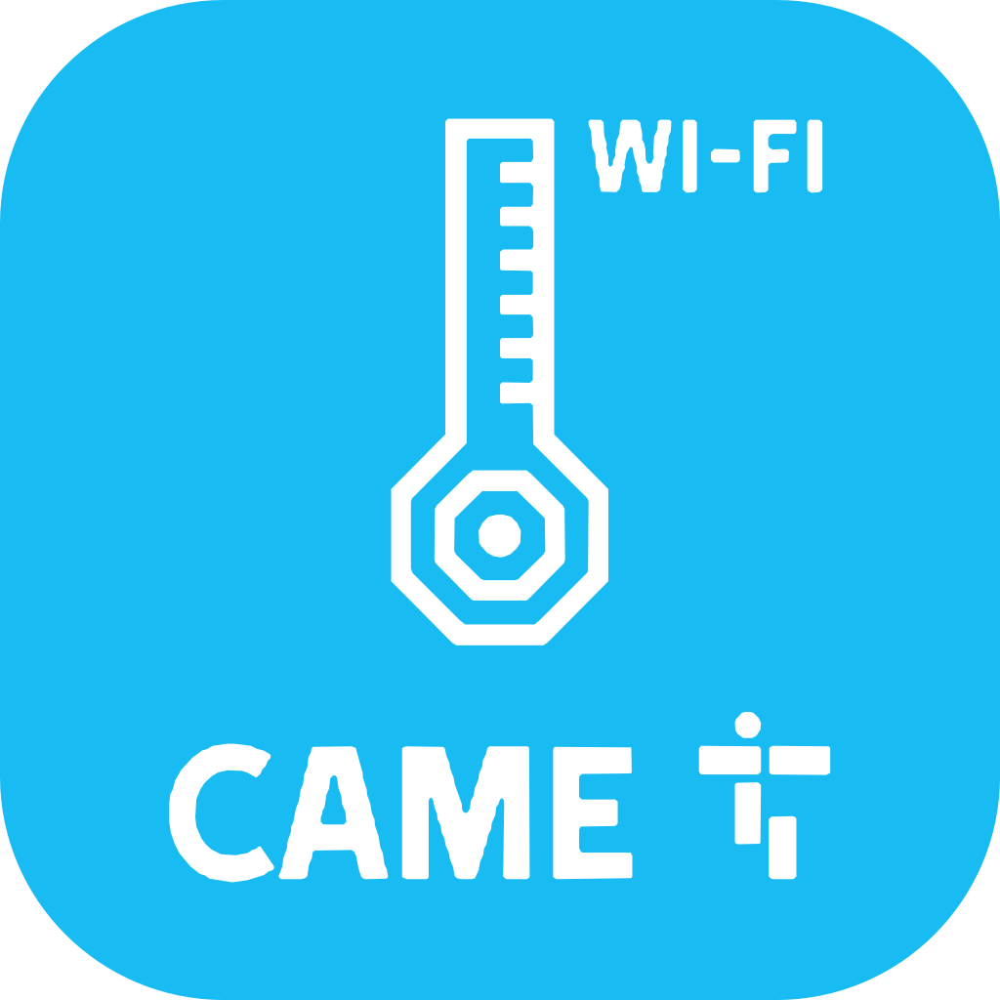

  

<h1 align="center">CAME Thermostat</h1>

Your CAME chronothermostat, natively in Home Assistant.

Unofficial Home Assistant integration for CAME Wi-Fi chronothermostats (TH/550,
TH/500 and siblings) through the CAME Connect cloud. It speaks the same private
API as the official CAME Connect web app and turns the thermostat into a proper
`climate` entity, plus the controls the device actually supports.

## What you get

- **A real climate entity** — HVAC mode, room temperature, target temperature,
  heating/cooling action and the auto band on T1–T3.
- **Live updates** — the thermostat WebSocket pushes changes, so the state moves
  within a second or two; polling is only a safety net.
- **The controls the device has** — operating mode, season, antifreeze, sensor
  offset, hysteresis and the winter/summer comfort levels, all as entities.
- **No CAME app needed** — once set up, everything is driven from Home
  Assistant and its automations.

## Get started

1. Install through HACS (custom repository) or copy the folder by hand.
2. Extract the OAuth client ID and secret from the official web app — they are
   not shipped with this integration.
3. Add the integration and pick your thermostat.

→ [Getting started](docs/getting-started.md)

## Documentation

- [Getting started](docs/getting-started.md) — install, credentials, first setup
  and options.
- [Entities and usage](docs/entities.md) — what every entity does, how the
  climate entity behaves, automation examples.
- [Troubleshooting](docs/troubleshooting.md) — setup errors, live updates,
  duplicated entities.
- [Internal docs](docs/internal/architecture.md) — architecture, the reverse
  engineered API, build and tests.

## Status

v1.0.0, verified against a live TH/550. The API is private and undocumented, so
CAME can change it at any time; the [API notes](docs/internal/api.md) are where
to start if something stops working.

> Not affiliated with or endorsed by CAME. Credentials are only sent to official
> `*.cameconnect.net` hosts.

## License

MIT
